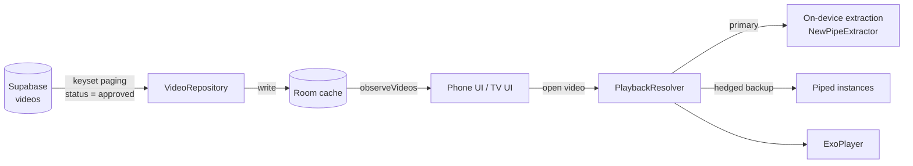

<div align="center">
  

  # واحة · Waha

  **A curated, ad-free video library for kids — on the phone and on Android TV.**

  [](https://developer.android.com)
  [](https://kotlinlang.org)
  [](https://developer.android.com/jetpack/compose)
  [](https://developer.android.com/training/tv)

  [Features](#features) • [Architecture](#architecture) • [Getting started](#getting-started) • [Build & run](#build--run) • [Testing](#testing) • [Project layout](#project-layout)
</div>

واحة (*Waha*, "oasis") is an Arabic-first Android app that plays a hand-picked library of children's videos. Every title is reviewed before it is published — nothing is suggested automatically, nothing is advertised, and no personal data leaves the device.

It ships as two apps that share one engine: a touch-first phone/tablet app, and a D-pad-driven Android TV app. Saves, watch history and recent searches are one library across both.

## Features

### Watching

- **Curated library** — categories, duration badges, pull-to-refresh, and a responsive grid that becomes a multi-column layout on tablets.
- **Continue watching** — a rail of part-watched videos that skips the ones barely opened (≤5%) or effectively finished (≥90%), and resumes at the exact second.
- **Player (phone)** — resumable playback, preferred quality (auto or a target height), playback speed, immersive fullscreen.
- **Watch more** — suggestions ranked as *next episode* → *shared series words* → *same category*, never re-suggesting something already watched.

### Finding things

- **Search** across the whole library and your recent queries, debounced so typing never waits on filtering.
- **Saved** and **history**, stored with DataStore and shared by both apps.

### On the TV

- Rail navigation with remembered focus: closing the player returns the remote to the card it left, not the top of the screen.
- Continue-watching shelf, then an "الكل" row of the whole library and one row per category — rows reshuffle when the library changes, so a shelf does not go stale.
- On-screen keyboard (Arabic, Latin, digits) with the results beside it, so typing never hides what you are narrowing down to.
- Remote-only player: OK plays and pauses, left/right seek 10 seconds with a hint at the side it moves towards, down opens the control panel, up brings the overlay back.

## Architecture

Three Gradle modules, one shared data layer. `:core` holds every rule the two apps must agree on; `:mobile` and `:tv` own only their screens.

| Module | Type | Responsibility |
| --- | --- | --- |
| `:core` | library | Repositories, Room cache, Supabase sync, stream resolution, DataStore stores, suggestion engine, playback models. No phone or TV UI. |
| `:mobile` | application | Compose Material 3 phone/tablet UI: home, search overlay, saved, history, settings, touch player. |
| `:tv` | application | Compose for TV UI behind a `LEANBACK_LAUNCHER` entry: rails, search, library, settings, remote player. |



**The library.** Room is the single source of truth and Supabase only feeds it: screens observe the cache (so the first frame is served from disk) and then ask for a refresh. Syncs are single-flight and throttled, page over the library with a keyset cursor on `(created_at, id)` — so rows published mid-walk can neither be skipped nor duplicated — and a full reconciliation runs once a day.

**Playback.** Stream URLs are resolved on the device, which is both faster and unaffected by YouTube's blocking of cloud IPs; public [Piped](https://github.com/TeamPiped/Piped) instances join as a hedged backup 1.5 s later and win if they answer first. Resolved URLs are kept in a small TTL cache, so reopening a video or switching back to a quality is instant. Waha hosts no media — it resolves and plays streams with the viewer's own network.

## Getting started

**Prerequisites**

- Android Studio (latest stable) with the Android SDK for API 37
- JDK 17 or newer
- A device or emulator on Android 7.0 (API 24) or newer
- A Supabase project with the curated library table

```bash
git clone https://github.com/ziroo-cf/waha.git
cd waha
```

Credentials are read from `local.properties` (ignored by git) and baked into `:core`'s `BuildConfig` at build time:

```properties
sdk.dir=/path/to/Android/sdk
SUPABASE_URL=https://<project>.supabase.co
SUPABASE_ANON_KEY=<anon-key>
```

> [!NOTE]
> The app expects a `videos` table with `id`, `title`, `thumbnail`, `category`, `duration`, `created_at` and `status`. Only rows with `status = 'approved'` are read, so the anon key only needs read access to that table. Without credentials the apps build and run, but the library cannot sync.

## Build & run

Prebuilt APKs are attached to the [latest release](https://github.com/ziroo-cf/waha/releases/latest) (`waha-mobile.apk` and `waha-tv.apk`). To build from source:

| Task | Command |
| --- | --- |
| Phone app | `./gradlew :mobile:assembleDebug` |
| TV app | `./gradlew :tv:assembleDebug` |
| Both | `./gradlew assembleDebug` |

Install on a connected device:

```bash
adb install -r mobile/build/outputs/apk/debug/mobile-debug.apk
adb install -r tv/build/outputs/apk/debug/tv-debug.apk
```

The TV APK is also installable on a phone — `leanback` and `touchscreen` are declared as *not required* so it can be side-loaded on a tablet or emulator during development. For real D-pad behaviour, use a TV AVD (720p landscape):

```bash
emulator -avd <tv-avd> &
adb install -r tv/build/outputs/apk/debug/tv-debug.apk
```

> [!TIP]
> The two apps have separate application IDs (`com.waha` and `com.waha.tv`), so both can be installed side by side and pointed at the same library.

## Testing

| Suite | Command | Runs on |
| --- | --- | --- |
| `:core` unit | `./gradlew :core:testDebugUnitTest` | JVM |
| `:mobile` unit | `./gradlew :mobile:testDebugUnitTest` | JVM |
| `:tv` unit | `./gradlew :tv:testDebugUnitTest` | JVM |
| `:tv` focus/UI | `./gradlew :tv:connectedDebugAndroidTest` | TV emulator or device |

The TV instrumented suite presses real remote keys at tagged nodes and reads the focused node, so navigation regressions fail the build rather than only looking wrong. It needs the TV emulator from above.

## Project layout

```
.
├── core/                    # shared data + domain layer (no UI)
│   └── src/main/java/com/waha/
│       ├── data/            # Supabase sync, Room, DataStore stores, Piped, extraction
│       ├── domain/          # VideoItem, playback resolution, suggestions, watch time
│       └── brand/           # shared palette both themes are built from
├── mobile/                  # phone + tablet app (com.waha)
│   └── src/main/java/com/waha/ui/screens/
├── tv/                      # Android TV app (com.waha.tv)
│   └── src/main/java/com/waha/tv/ui/screens/
├── docs/                    # notes
└── gradle/libs.versions.toml
```

## Built with

[NewPipeExtractor](https://github.com/TeamNewPipe/NewPipeExtractor) for on-device stream extraction, [Piped](https://github.com/TeamPiped/Piped) as the fallback source, [Supabase](https://supabase.com) for the published library, [Media3](https://developer.android.com/media/media3) for playback, and [Jetpack Compose](https://developer.android.com/jetpack/compose) with [Compose for TV](https://developer.android.com/training/tv/playback/compose) for both UIs.
