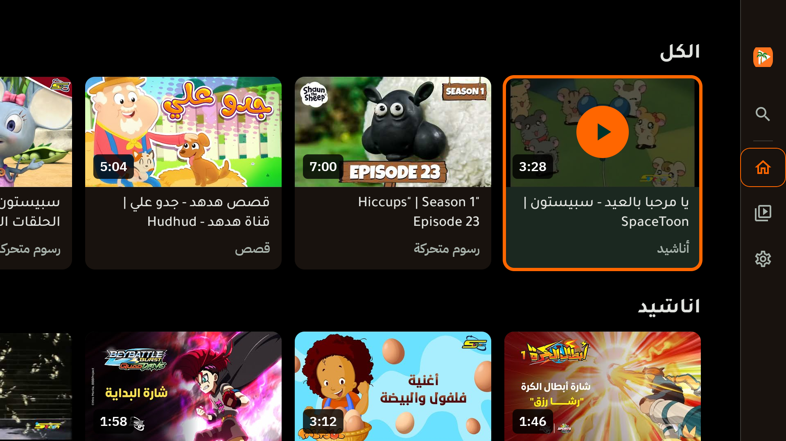
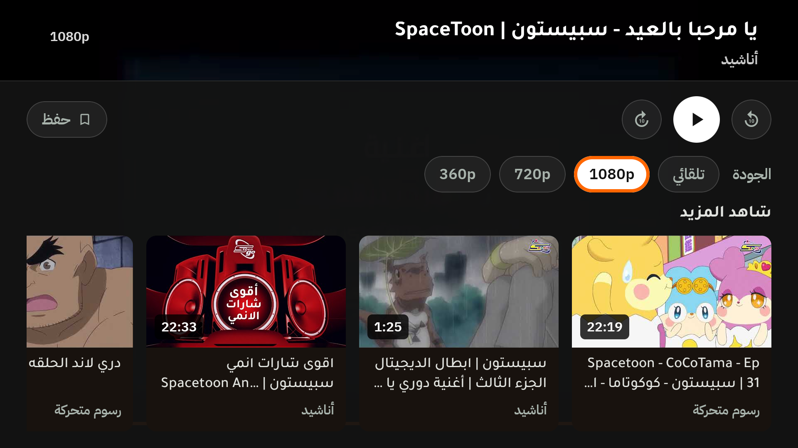
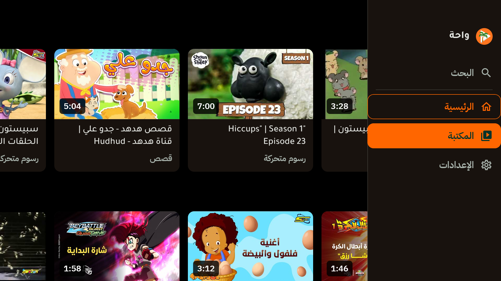
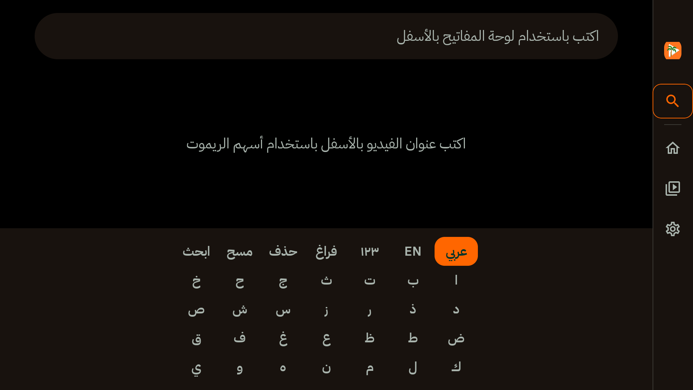

# تدقيق أداء وحدة `:tv` — هدف 60fps على أجهزة التلفاز الضعيفة

**النطاق:** كل ملفات `tv/src/main` (‏~2,900 سطر Kotlin) وطبقة البيانات في `:core` التي تستهلكها الواجهة (`observeVideos` / Room / المخازن).
**نوع العمل:** تحليل وتشخيص فقط — لم يُعدَّل أي كود في هذه الجلسة.

---

## 0. الملخص التنفيذي

الواجهة مكتوبة أصلاً بذوق «TV سريع»: لا يوجد `Modifier.blur` ولا `RenderEffect` ولا ظلال يدوية ولا أنيميشن ولا تكبير عند التركيز، والتخطيط بأبعاد ثابتة (`WahaTvDimens`)، ونصوص المدة محسوبة مسبقاً في Room. هذا يقلّل العمل المطلوب كثيراً.

المشاكل الحقيقية المتبقية ستّ، مرتّبة بالأثر:

| # | المشكلة | الأثر |
|---|---|---|
| TV-01 | «الغلو» في tv-material ليس حلقة مسطحة: هو **blur** يُرسم بـ `Paint.setShadowLayer` لكل بطاقة/مفتاح/صف عند التركيز | 🔴 عالٍ — أثقل عملية GPU في التطبيق، وتحدث في اللحظة التي نحتاج فيها الإطارات أكثر ما نحتاج (حركة الريموت) |
| TV-06 | الشريط الجانبي يغيّر عرضه 56dp ↔ 256dp عند كل دخول/خروج للتركيز ⇒ إعادة تخطيط **للشاشة كلها** | 🔴 عالٍ — jank عند كل انتقال بين المحتوى والشريط |
| TV-09 + TV-08 | المزامنة تكتب Room على دفعات (500 صف/معاملة) ⇒ عدة انبعاثات لكل sync، وكل انبعاث يعيد بناء الأرفف **على الـmain thread** بترتيب عشوائي جديد | 🔴 عالٍ — 3–8 عمليات O(n) كاملة أثناء أول تحميل، وتغيّر ترتيب البطاقات أمام المشاهد |
| TV-10 | مؤقّت التقدّم (500ms) يُقرأ داخل جسم `TvPlayerScreen` ⇒ إعادة تركيب لشجرة المشغّل كاملة مرتين كل ثانية | 🔴 عالٍ — تقطيع دوري أثناء التشغيل، وأثقل على الأجهزة الضعيفة |
| TV-11 | كل حرف في البحث يعيد تركيب 35 مفتاحاً + يفلتر المكتبة على الـmain | 🔴 عالٍ — تقطيع عند الكتابة، وهي أكثر شاشة تُستخدم بالريموت |
| TV-22 | `AndroidView` يُفكّ ويُعاد إنشاؤه بين Loading و Playing ⇒ تدمير/إنشاء `SurfaceView` عند تغيير الجودة | 🔴 عالٍ — وميض أسود + إعادة تهيئة سطح الفيديو |

---

## 1. ما هو سليم أصلاً (لا نلمسه)

- لا `Modifier.blur`، لا `RenderEffect`، لا `Modifier.shadow`، لا `graphicsLayer` في أي شاشة تلفاز.
- لا أنيميشن على التركيز: `FocusScale = 1f` والحدود تُرسم في نفس إطار وصول التركيز — وهذا صحيح تماماً لجهاز ضعيف، والتخطيط لا يتحرك تحت عين المشاهد.
- `TvDestination` والأيقونات و`VideoItem` نماذج ثابتة (Stable) ⇒ Compose يستطيع تخطّي إعادة التركيب.
- نص المدة يُنسَّق مرة واحدة عند الكتابة إلى Room (`VideoEntity.durationText`)، لا في كل بطاقة.
- المخازن تملك snapshots غير قابلة للتغيير و`Set` للبحث بـO(1) بدل قائمة.
- ترتيب المشغّل: `PlaybackResolver` من `:core`، والاقتراحات تُحسب على `Dispatchers.Default`.
- بنية القوائم سليمة: `LazyColumn` للشاشة و`LazyRow` لكل رفّ (‏[TvComponents.kt:429](../tv/src/main/java/com/waha/tv/ui/screens/TvComponents.kt#L429)) مع سقف 20 عنصراً للرفّ — فلا تُبنى مئات البطاقات في الذاكرة. المشكلة ليست في البنية، بل في عدد مرات **إعادة بنائها** (‏TV-08/TV-09).

---

## 2. GPU / Overdraw / Layers

### TV-01 — «Glow» هو blur حقيقي، ويُدفع ثمنه عند كل حركة ريموت 🔴 عالٍ

**الدليل:** [TvComponents.kt:101](../tv/src/main/java/com/waha/tv/ui/screens/TvComponents.kt#L101) يبني `Glow(elevation = 16.dp)` ويُمرَّر إلى البطاقة في [TvComponents.kt:178](../tv/src/main/java/com/waha/tv/ui/screens/TvComponents.kt#L178)، وأيضاً إلى مفاتيح لوحة المفاتيح [TvSearchScreen.kt:327](../tv/src/main/java/com/waha/tv/ui/screens/TvSearchScreen.kt#L327)، وصفوف الإعدادات [TvSettingsScreen.kt:119](../tv/src/main/java/com/waha/tv/ui/screens/TvSettingsScreen.kt#L119).

**ما يفعله فعلاً:** في `androidx.tv:tv-material:1.1.0` لا يُرسم الـGlow كحدود؛ العقدة `SurfaceGlowNode` تحسب `glowBlurRadiusPx` وتستدعي `Paint.setShadowLayer(...)` ثم ترسم `drawRoundRect` للـoutline. أي **blur mask filter** على مساحة البطاقة كاملة (240dp × ~180dp) بنصف قطر 16dp.

تبعاته:
1. على Mali-400/450 وAmlogic الضعيفة، هذه أغلى عملية fill-rate في الإطار، وتحدث بالضبط عند تحريك الريموت (أي عند قياس الـjank).
2. في البحث، كل ضغطة حرف تنقل التركيز ⇒ blur جديد لكل مفتاح.
3. سلوكه متغيّر بين الأجهزة/الإصدارات (بعض الأجهزة تُهمله بصمت) ⇒ الواجهة تعتمد على تأثير غير مضمون بدل إشارة تصميمية مضمونة.

**الحل المقترح:** حذف `tvFocusGlow()` من كل مكوّن والاعتماد على ما هو موجود أصلاً: حد 4dp بلون `Accent` + تعبئة/تظليل بسيط.
للتمييز البصري الذي كان يقدّمه الغلو نستخدم بديلاً مسطحاً بتكلفة ~صفر:
- حلقة داخلية 2dp بلون `Accent.copy(alpha = 0.55f)` مرسومة بـ`drawBehind` (بلا عقدة تخطيط جديدة)، أو
- رفع سطوع خلفية البطاقة درجة واحدة عند التركيز (تعبئة لونية صريحة، موجودة أصلاً عبر `focusedContainerColor`).

**الأثر:** High — أكبر مكسب GPU منفرد. **الجهد:** S (حذف بارامتر + تعديل دالة واحدة + تحديث صور/اختبارات).

---

### TV-02 — خلفيات كاملة متراكبة + تدرّج الشريط 🟡 متوسط

**الدليل:** `windowBackground` أسود في [themes.xml:6](../tv/src/main/res/values/themes.xml#L6)، ثم `Box.background(Background)` في [TvApp.kt:76](../tv/src/main/java/com/waha/tv/ui/screens/TvApp.kt#L76)، ثم `Row.background(Background)` مرة أخرى في [TvMainScreen.kt:166](../tv/src/main/java/com/waha/tv/ui/screens/TvMainScreen.kt#L166)، وفوقها تدرّج «الزجاج» في [TvColors.kt:60](../tv/src/main/java/com/waha/tv/ui/theme/TvColors.kt#L60).

**النتيجة:** الشاشة تُملأ 2–3 مرات كل إطار (overdraw كامل)، والشريط يضيف تدرّج ألفا بعرض 256dp فوق المحتوى. على GPUs الميديا تيك هذا يترجم مباشرة إلى استهلاك نطاق ترددي.

**الحل:** الإبقاء على تعبئة واحدة (جذر `TvApp` فقط) وحذف الباقي؛ واستبدال تدرّج الشريط بلون `Surface` صلب مع حد فاصل 1dp. «الزجاج» غير قابل للتحقيق فعلياً على Compose (لا blur لما تحته) فهو يدفع ثمن شفافية بلا مكسب بصري.

**الأثر:** Medium. **الجهد:** S.

---

### TV-03 — قصّ الحواف المستديرة لكل بطاقة + طبقة scrim إضافية 🟡 متوسط

**الدليل:** `Card(shape = RoundedCornerShape(12.dp))` في [TvComponents.kt:171](../tv/src/main/java/com/waha/tv/ui/screens/TvComponents.kt#L171) يطبّق `clip` على البطاقة كاملة (بما فيها كتلة النص التي لا تحتاج قصّاً)، وكل `clip` بشكل غير مستطيل ⇒ طبقة RenderNode منفصلة لكل بطاقة، أي كسر دمج الرسم (batching).

وفوق ذلك، عند التركيز تُضاف طبقة `MediaScrimSoft` بعرض البطاقة كاملة [TvComponents.kt:199](../tv/src/main/java/com/waha/tv/ui/screens/TvComponents.kt#L199) + دائرة accent + أيقونة — أي ثلاث طبقات فوق الصورة في البطاقة المركّزة.

**الحل:**
- إبقاء شكل البطاقة مستطيلاً، وقصّ **الصورة وحدها** (`clip` واحد على الطبقة التي تحتاجها).
- استبدال طبقة الـscrim + دائرة التشغيل بعنصر واحد يُرسم بـ`drawWithContent`/`drawBehind` (تظليل + مثلث)، فلا تُضاف عقد تخطيط ولا تركيب عند التركيز.

**الأثر:** Medium. **الجهد:** M.

---

### TV-04 — إنشاء كائنات التصميم في كل إعادة تركيب 🟢 منخفض/متوسط

`tvFocusBorder()` و`tvFocusGlow()` و`tvItemColors()` تُنتج كائنات جديدة (`BorderStroke`, `Glow`, `CardColors`) في كل تركيب لكل بطاقة/مفتاح. مع 35 مفتاحاً في البحث و~20 بطاقة ظاهرة، هذا تخصيص مستمر وضغط GC على جهاز بذاكرة 1GB.
**الحل:** `remember` للقيم الثابتة أو تحويلها إلى `val` غير composable (اللون يُقرأ مرة واحدة من الثيم).
**الأثر:** Low/Medium. **الجهد:** S.

---

### TV-05 — شفافيات متعددة داخل البطاقة 🟢 منخفض

سطح البطاقة + مستطيل العنصر النائب + الصورة + شارة المدة + شارة «محفوظ» = 4–5 طبقات في مساحة صغيرة. القيمة البصرية موجودة، لكن يمكن دمج خلفية العنصر النائب مع سطح البطاقة لتوفير طبقة.
**الأثر:** Low. **الجهد:** S.

---

## 3. إعادة التركيب والتخطيط (Jank)

### TV-06 — عرض الشريط يتغيّر ⇒ إعادة تخطيط كاملة للشاشة 🔴 عالٍ

**الدليل:** `RailWidthResting = 56.dp` و`RailWidthFocused = 256.dp` [TvDimens.kt:73](../tv/src/main/java/com/waha/tv/ui/screens/TvDimens.kt#L73) و[TvDimens.kt:76](../tv/src/main/java/com/waha/tv/ui/screens/TvDimens.kt#L76)، ويُطبَّق في [TvMainScreen.kt:233](../tv/src/main/java/com/waha/tv/ui/screens/TvMainScreen.kt#L233) داخل `Row` حيث المحتوى `weight(1f)`.

**الأثر:** كل دخول/خروج للشريط يغيّر عرض عمود المحتوى بمقدار 200dp ⇒ إعادة قياس وتخطيط لكل الأرفف الظاهرة وكل `LazyRow` بداخلها في إطار واحد. هذا يحدث مرتين على الأقل في كل رحلة ريموت (دخول + خروج)، وهو jank مضمون على Mali-450.

**الحل المقترح (يحتاج قرارك):** الشريط يصبح **طبقة فوق المحتوى** لا عموداً في التخطيط:
- المحتوى يحتفظ بعرض ثابت دائماً (لا يتغيّر أبداً).
- الشريط المفتوح (256dp) يُرسم فوق المحتوى بلون معتم + ظل مسطح/حد فاصل 1dp بدل الظل الضبابي.
- `Row` تُستبدل بـ`Box` + `Modifier.padding(end = 56.dp)` ثابت للمحتوى.

هذا يحوّل العمل من «إعادة تخطيط الشجرة» إلى «رسم مستطيل فوقها» — فرق كبير على الأجهزة الضعيفة.

**الأثر:** High. **الجهد:** M (يلمس `TvMainScreen` + اختبارات التركيز).

---

### TV-07 — المرور على الشريط = تغيير الصفحة فوراً 🔴 عالٍ

**الدليل:** [TvMainScreen.kt:253](../tv/src/main/java/com/waha/tv/ui/screens/TvMainScreen.kt#L253) وما بعده: `onDestinationSelect(item)` يُنفَّذ لحظة وصول التركيز (بلا زر OK).

**الأثر:** كل خطوة D-pad على الشريط تُدمّر شجرة الشاشة السابقة وتبني التالية. البحث مثلاً يبني ~220 عقدة (35 مفتاحاً + نتائج + حقل). تمرير الريموت بسرعة من «الرئيسية» إلى «الإعدادات» = بناء ثلاث شاشات كاملة في ثانية واحدة، وضياع حالة التمرير لكل واحدة منها.

**الحل المقترح:** فصل «الاختيار» عن «الفتح»:
- المرور يغيّر التظليل فقط (والشريط يُفتح بصرياً).
- الضغط على OK يفتح الصفحة.
- استثناء: بعد الرجوع من المحتوى، يبقى السلوك الحالي (سناب إلى الصفحة الحالية).

هذا هو سلوك YouTube TV نفسه، ويُلغي كل التركيب غير الضروري.

**الأثر:** High (jank + أخطاء تنقل). **الجهد:** S/M + تحديث اختبارات `TvTopNavigationFocusTest`.

---

### TV-08 — بناء الأرفف على الـmain thread مع خلط عشوائي جديد كل مرة 🔴 عالٍ

**الدليل:** [TvHomeScreen.kt:98](../tv/src/main/java/com/waha/tv/ui/screens/TvHomeScreen.kt#L98): `remember(videos) { TvRails.build(videos) }` — التنفيذ داخل التركيب، أي على الـmain.

`TvRails.build` يقوم بـ`shuffled()` للمكتبة كاملة + `filter` لكل تصنيف على حدة (O(التصنيفات × n))، ويستخدم `Random.Default` في [TvHomeRails.kt:57](../tv/src/main/java/com/waha/tv/ui/screens/TvHomeRails.kt#L57).

**الأثر المزدوج:**
1. مكتبة 3000 فيديو و20 تصنيفاً ⇒ ~60 ألف مقارنة + تخصيصات، في كل انبعاث Room (وانظر TV-09: هناك عدة انبعاثات لكل sync).
2. لأن البذرة عشوائية كل مرة، **يرى المشاهد ترتيباً مختلفاً للبطاقات** بعد كل مزامنة/إعادة تركيب — قفزة بصرية بلا سبب مفهوم.

**الحل:**
- نقل بناء الأرفف إلى `TvHomeViewModel` (أو `observeLibrary()` في `:core`) على `Dispatchers.Default`، وتسليم الأرفف جاهزة في الـstate.
- تثبيت الترتيب: بذرة مشتقة من معرّف المكتبة (أو من `lastSyncAtMs`) بدل `Random.Default`، حتى يبقى الرف ثابتاً بين الانبعاثات.

**الأثر:** High. **الجهد:** M.

---

### TV-09 — عدة انبعاثات Room لكل مزامنة 🔴 عالٍ

**الدليل:** [Videorepository.kt:138](../core/src/main/java/com/waha/data/Videorepository.kt#L138): `entities.chunked(500).forEach { dao.upsertAll(it) }`، ثم [Videorepository.kt:143](../core/src/main/java/com/waha/data/Videorepository.kt#L143) حذف منفصل. كل معاملة `@Upsert` تُطلق `InvalidationTracker` ⇒ الـFlow في [Videorepository.kt:63](../core/src/main/java/com/waha/data/Videorepository.kt#L63) يعيد الاستعلام ويُصدر قائمة جديدة.

**النتيجة:** مكتبة 3000 صف ⇒ 6 كتابات + حذف ⇒ 7 انبعاثات ⇒ 7 خرائط كاملة + 7 إعادات بناء للأرفف (TV-08) على الـmain.

**ملاحظة صحّة مهمة:** التعليق في المستودع يقول إن الكتابة «في النهاية» تترك الكاش السابق سليماً عند فشل الشبكة — لكن بدون معاملة واحدة، فشل أثناء الكتابة يترك كاشاً جزئياً. الحلّان مكسب واحد:

```kotlin
database.withTransaction {
    entities.chunked(UPSERT_CHUNK).forEach { dao.upsertAll(it) }
    if (walk.complete) dao.deleteNotInGeneration(startedAt)
}
```

⇒ انبعاث واحد، وذرّية كاملة.

**الأثر:** High (jank + صحّة بيانات). **الجهد:** S.

---

### TV-10 — مؤقّت التشغيل يعيد تركيب شجرة المشغّل كل 500ms 🔴 عالٍ

**الدليل:** `LaunchedEffect` يحدّث `positionMs` كل 500ms [TvPlayerScreen.kt:263](../tv/src/main/java/com/waha/tv/ui/screens/TvPlayerScreen.kt#L263)، و`positionMs` **يُقرأ في جسم `TvPlayerScreen`** (كمَعامل لـ`PlayerBottomOverlay` في [TvPlayerScreen.kt:473](../tv/src/main/java/com/waha/tv/ui/screens/TvPlayerScreen.kt#L473))، لا داخل عنصر صغير معزول.

**النتيجة:** كل 500ms يعاد تنفيذ جسم المشغّل: الشروط (`playback`, `overlayVisible`, `panelVisible`)، و`AndroidView` مع `update` الذي يعيد إسناد `view.player` و`keepScreenOn`، و`Slider` الخاص بـMaterial 3 (قياس + رسم كامل) — مرتين في الثانية، إلى الأبد، فوق فيديو يعمل.

**الحل:**
- عزل قراءة الموضع: شريط تقدّم مخصص يُرسم بـ`Canvas`/`drawBehind` يقرأ `State<Long>` داخل طور الرسم فقط (لا إعادة تركيب).
- النصّان (الحالي/الكلي) يعيدان التركيب مرة كل ثانية فقط عبر `derivedStateOf` على الثواني.
- تقليل التحديث إلى 250ms للتقدّم و1000ms للنص (أو `player.currentPosition` مباشرة عند الرسم).

**الأثر:** High. **الجهد:** M.

---

### TV-11 — لوحة المفاتيح تُعاد بالكامل مع كل حرف 🔴 عالٍ

**الدليل:** `query` يُقرأ في `remember` [TvSearchScreen.kt:65](../tv/src/main/java/com/waha/tv/ui/screens/TvSearchScreen.kt#L65) وفي اللامبدات المارّة إلى اللوحة [TvSearchScreen.kt:117](../tv/src/main/java/com/waha/tv/ui/screens/TvSearchScreen.kt#L117) — كل لامبدا تلتقط `query` ⇒ معاملات غير ثابتة ⇒ إعادة تركيب `TvOnScreenKeyboard` و**كل مفاتيحها الـ35** (`Card` + حد + glow) عند كل ضغطة حرف.

وفوق ذلك `allVideos.filter { ... }` على الـmain لكل ضغطة [TvSearchScreen.kt:65](../tv/src/main/java/com/waha/tv/ui/screens/TvSearchScreen.kt#L65).

**الحل:**
- حامل حالة للبحث (`SearchState`) بـ`update`/`rememberUpdatedState` بحيث تُبنى اللوحة مرة واحدة وتبقى معاملاتها ثابتة.
- ترشيح متأخّر (debounce ~120ms) على `Dispatchers.Default` وبحث مُطبَّع مسبقاً (lowercase/بلا تشكيل) في الفهرس.

**الأثر:** High. **الجهد:** M.

---

### TV-12 — كل بطاقة تشترك في «كل» المحفوظات 🟡 متوسط

**الدليل:** `SavedVideosStore.isSaved(video.id)` يُقرأ مباشرة في التركيب [TvComponents.kt:161](../tv/src/main/java/com/waha/tv/ui/screens/TvComponents.kt#L161).

**النتيجة:** حفظ فيديو واحد من لوحة المشغّل يُبطل تركيب **كل** البطاقات المركّبة (خلف المشغّل أيضاً). القراءة نفسها O(1)، لكن إعادة التركيب ليست مجانية على جهاز ضعيف.

**الحل:** قراءة المجموعة مرة واحدة في `TvVideoRow`/الشاشة وتمرير `isSaved: Boolean` للبطاقة، أو `derivedStateOf` لكل معرّف.

**الأثر:** Medium. **الجهد:** S.

---

### TV-13 — الرئيسية تشترك في تاريخ المشاهدة كاملاً 🟡 متوسط

**الدليل:** `remember(WatchHistoryStore.snapshot)` [TvHomeScreen.kt:103](../tv/src/main/java/com/waha/tv/ui/screens/TvHomeScreen.kt#L103).

**النتيجة:** أي `updateProgress` (يحدث عند الإيقاف المؤقت وعند إغلاق المشغّل) يعيد تركيب الرئيسية — وهي **ما تزال مركّبة تحت المشغّل**. أي أن الضغط على «إيقاف» قد يُنتج إطاراً مفقوداً في لحظة ظهور لوحة التحكم.

**الحل:** `derivedStateOf` على `(id → fraction)` فقط، وقراءتها داخل عناصر الرف لا في جذر الشاشة.

**الأثر:** Medium. **الجهد:** S/M.

---

### TV-14 — حالة تمرير الأرفف تُفقد عند تغيير الوجهة 🟡 متوسط (UX)

**الدليل:** `rememberLazyListState()` في [TvHomeScreen.kt:96](../tv/src/main/java/com/waha/tv/ui/screens/TvHomeScreen.kt#L96) داخل شاشة تُدمَّر عند تبديل `destination` في [TvApp.kt:82](../tv/src/main/java/com/waha/tv/ui/screens/TvApp.kt#L82).

**النتيجة:** بحث ← رجوع ← الرئيسية: الأرفف تعود إلى أول صف وأول بطاقة. المشاهد فقد مكانه.

**الحل:** `rememberSaveable` (‏`LazyListState` يملك `Saver`) أو حفظ الحالة لكل وجهة في `TvApp`.

**الأثر:** Medium. **الجهد:** S.

---

### TV-15 — `TvApp` يعيد التركيب مع كل تغيير في المكتبة بينما الفيديو يعمل 🟢 منخفض

`collectAsState` في [TvApp.kt:47](../tv/src/main/java/com/waha/tv/ui/screens/TvApp.kt#L47) يمرّر `uiState` إلى الشجرة كاملة، بما فيها المشغّل المفتوح (‏[allVideos](../tv/src/main/java/com/waha/tv/ui/screens/TvApp.kt#L109) يتغيّر ⇒ إعادة حساب الاقتراحات).
**الحل:** تثبيت `allVideos` الذي يراه المشغّل عند فتحه (snapshot)، أو فصل حالة المشغّل عن حالة المكتبة.
**الأثر:** Low/Medium. **الجهد:** S.

---

## 4. الريموت وإدارة التركيز (D-Pad)

### TV-16 — تركيز لوحة المشغّل «مقامرة» صامتة 🔴 عالٍ (خطر تعليق الريموت)

**الدليل:** [TvPlayerScreen.kt:294](../tv/src/main/java/com/waha/tv/ui/screens/TvPlayerScreen.kt#L294):

```kotlin
withFrameNanos { }
runCatching {
    if (panelVisible) panelFocusRequester.requestFocus() else rootFocusRequester.requestFocus()
}
```

ومع `focusable(enabled = !panelVisible)` على جذر المشغّل [TvPlayerScreen.kt:357](../tv/src/main/java/com/waha/tv/ui/screens/TvPlayerScreen.kt#L357).

**الخطر:** إذا فشل طلب التركيز (إطار واحد غير كافٍ على جهاز بطيء، أو العقدة لم تُوضَع بعد)، يبتلع `runCatching` الاستثناء ولا يوجد **أي** عنصر قابل للتركيز على الشاشة ⇒ الريموت ميت تماماً حتى زر الرجوع. نفس المخاطرة في [TvPlayerScreen.kt:312](../tv/src/main/java/com/waha/tv/ui/screens/TvPlayerScreen.kt#L312) للمشغّل نفسه.

**الحل:**
- ربط الطلب بـ`onPlaced` (أو `FocusRequester` + `focusRequesterModifierNode`) بدل انتظار إطار واحد.
- عدم ابتلاع الفشل: إعادة المحاولة في الإطار التالي، ثم fallback مضمون (جذر المشغّل يبقى قابلاً للتركيز دائماً).
- اختبار أدواتي: «افتح اللوحة ثم اضغط يساراً في أول إطار» — يجب أن يبقى التركيز داخل الشاشة.

**الأثر:** High (موثوقية). **الجهد:** S/M.

---

### TV-17 — لا استعادة تركيز إلى البطاقة التي غادرها المشاهد 🟡 متوسط

**الدليل:** الخروج من المشغّل يعيد التركيز إلى الشريط عبر `LaunchedEffect(current, refocusRequests)` [TvMainScreen.kt:265](../tv/src/main/java/com/waha/tv/ui/screens/TvMainScreen.kt#L265) ثم «سناب» إلى وجهة الشريط، لا إلى البطاقة.

**النتيجة:** المشاهد يعود إلى أعلى الشاشة/الشريط بدل البطاقة نفسها؛ مع TV-07 يصبح الطريق طويلاً.

**الحل:** حفظ آخر بطاقة مركّزة (في `TvApp`) واستعادة التركيز إليها بعد إغلاق المشغّل، مع الرجوع للشريط فقط إذا اختفت البطاقة.

**الأثر:** Medium. **الجهد:** M.

---

## 5. ربط الواجهة مع `observeVideos()` (Room)

### TV-19 — لا معالجة أخطاء على تدفّق Room 🟡 متوسط

**الدليل:** [TvHomeViewModel.kt:43](../tv/src/main/java/com/waha/tv/ui/screens/TvHomeViewModel.kt#L43) — `mapNotNull` ثم `collect` بلا `catch`.

أي استثناء (كاش تالف، ترحيل فاشل، قرص ممتلئ) يُنهي كوروتين الـViewModel بصمت ⇒ الشاشة تبقى على `Loading` إلى الأبد، بلا زر إعادة محاولة.

**الحل:** `.catch { _uiState.value = TvUiState.Error(...) }` قبل `collect`.

**الأثر:** Medium (موثوقية). **الجهد:** S.

---

### TV-20 — «مكتبة فارغة» لا يمكن تمييزها عن «قيد التحميل» 🟡 متوسط (UX)

**الدليل:** `mapNotNull { if (videos.isEmpty()) return@mapNotNull null }` [TvHomeViewModel.kt:46](../tv/src/main/java/com/waha/tv/ui/screens/TvHomeViewModel.kt#L46) يبتلع الحالة الفارغة نهائياً، فلا تصل أبداً إلى `TvHomeScreen` التي تملك رسالة «لا توجد فيديوهات منشورة بعد» (‏[TvHomeScreen.kt:79](../tv/src/main/java/com/waha/tv/ui/screens/TvHomeScreen.kt#L79)).

**الحل:** حالة صريحة `Empty` تُرسَل بعد أول انبعاث مكتمل (بعد انتهاء `refresh` أو بعد أول إصدار Room).

**الأثر:** Medium (UX، والأجهزة الضعيفة قد تفشل مزامنتها أكثر). **الجهد:** S.

---

### TV-21 — مقارنة حالات O(n) بلا `distinctUntilChanged` منطقي 🟢 منخفض

`StateFlow` يقارن القوائم بالمساواة البنيوية على الـmain؛ مع TV-09 يصبح هذا مقارنة 3000 عنصر عدة مرات لكل sync. بعد إصلاح TV-09 والتقليل إلى انبعاث واحد، يزول الأثر عملياً.

---

## 6. المشغّل والوسائط

### TV-22 — سطح الفيديو يُدمَّر ويُعاد بين Loading و Playing 🔴 عالٍ

**الدليل:** `AndroidView` موجود فقط داخل `if (playback == TvPlaybackState.Playing)` [TvPlayerScreen.kt:416](../tv/src/main/java/com/waha/tv/ui/screens/TvPlayerScreen.kt#L416)، وأي تغيير جودة يضع الحالة على `Loading` [TvPlayerScreen.kt:240-252](../tv/src/main/java/com/waha/tv/ui/screens/TvPlayerScreen.kt#L240).

**النتيجة:** تغيير الجودة ⇒ إزالة `PlayerView` (تدمير `SurfaceView`) ثم إعادة إنشائه ⇒ وميض أسود، إعادة تهيئة surface/mediacodec، وتأخير ملموس قبل أول إطار. على الأجهزة الضعيفة قد يظهر أيضاً خط أسود/تقطيع لحظي.

**الحل:** إبقاء `AndroidView` مركّباً دائماً (حتى أثناء `Loading`/`Error`) وإظهار المؤشر/رسالة الخطأ كطبقات فوقه. لا حاجة لتغيير `player` نفسه — يُنشأ مرة واحدة في `remember`.

**الأثر:** High (UX + أداء). **الجهد:** S.

---

### TV-23 — `Slider` من Material 3 لشريط تقدّم غير تفاعلي 🟡 متوسط

**الدليل:** [TvPlayerScreen.kt:648](../tv/src/main/java/com/waha/tv/ui/screens/TvPlayerScreen.kt#L648) — `Slider(enabled = false)` يُقاس ويُرسم كاملاً (مسار + مقبض + تفاعل معطّل) ويتحرك مع `positionMs`.

**الحل:** شريط بارتفاع 4dp يُرسم بـ`Canvas` (مسار + تعبئة accent)، بلا قياس Material ولا مقبض، ويُقرأ الموضع داخل طور الرسم فقط.

**الأثر:** Medium. **الجهد:** S.

---

### TV-24 — إعدادات ExoPlayer افتراضية على جهاز 1GB 🟡 متوسط

**الدليل:** [PlaybackResolver.kt:130](../core/src/main/java/com/waha/domain/PlaybackResolver.kt#L130): `ExoPlayer.Builder(context).build()` — أي `DefaultLoadControl` (حتى 50 ثانية مخزون) و`DefaultAllocator` افتراضي.

على أجهزة 1GB، ومع المصادر المدمجة (`MergingMediaSource` = مساران)، هذا يعني ذاكرة مخزون مضاعفة واحتمال تقطيع/إعادة تهيئة عند ضغط الذاكرة.

**الحل:** `DefaultLoadControl` بـ`maxBufferMs = 15–20s` و`DefaultAllocator(true, 64 * 1024)` في وحدة التلفاز (أو معامل في `WahaPlayer.create` لفرق الجهاز)، مع الحفاظ على السلوك الحالي للهاتف.

**الأثر:** Medium. **الجهد:** S.

---

### TV-25 — تدرّجات ألفا فوق الفيديو 🟢 منخفض

تدرّج أعلى/أسفل الشاشة فوق فيديو يعمل: طبقة ألفا كاملة العرض تُرسم عند كل تحديث للتقدّم. بعد TV-10 تصبح التكلفة محصورة في إعادة الرسم لا التركيب. يمكن استبدالها بمستطيلات ثابتة شبه معتمة إن أردنا أقصى توفير.

---

## 7. البناء وبدء التشغيل

### TV-26 — R8 معطّل في إصدار release 🔴 عالٍ (بدء التشغيل)

**الدليل:** [tv/build.gradle.kts:29](../tv/build.gradle.kts#L29):

```kotlin
release { optimization { enable = false } }
```

بلا تصغير/تحسين: dex أكبر، تحميل أصناف أبطأ، وCompose نفسها بلا تحسينات R8. على جهاز ضعيف هذا يُرى مباشرة في زمن أول إطار.

**الحل:** تفعيل التحسين مع `proguard-rules` لـNewPipe/Supabase/kotlinx.serialization، والتحقق من البناء والإصدار على الجهاز.

**الأثر:** High (‏TTID/TTFD). **الجهد:** M (يحتاج قواعد keep + اختبار إصدار).

---

### TV-27 — لا Baseline Profile 🟡 متوسط/عالٍ

لا توجد حزمة `androidx.profileinstaller` ولا ملفات baseline في `:tv`. أول تشغيل على TV قد يفقد إطارات أثناء JIT.
**الحل:** إضافة `profileinstaller` + baseline profile (يمكن توليده من `androidTest` عبر Macrobenchmark).
**الأثر:** Medium/High. **الجهد:** M.

---

### TV-28 — `material-icons-extended` كامل 🟢 منخفض

مكتبة ضخمة مقابل 5 أيقونات. بعد تفعيل R8 يزول أغلب الأثر. بديل: أيقونات vector محلية أو `material-icons-core`.

---

## 8. الأولويات المقترحة

### P0 — هذه الجلسة (أعلى مكسب، أقل مخاطرة)
1. **TV-01** حذف الغلو (blur) من كل المكوّنات.
2. **TV-06** الشريط كطبقة فوق المحتوى بعرض ثابت.
3. **TV-09** معاملة واحدة للمزامنة (انبعاث Room واحد + ذرّية).
4. **TV-08** بناء الأرفف على Default + ترتيب ثابت.
5. **TV-10** عزل قراءة موضع التشغيل عن إعادة التركيب.
6. **TV-22** إبقاء سطح الفيديو مركّباً دائماً.
7. **TV-16** تركيز لوحة المشغّل بدون `runCatching` صامت.

### P1 — نفس الجلسة إن سمح الوقت
**TV-07** (الفتح بـOK بدل المرور)، **TV-11** (لوحة مفاتيح ثابتة + ترشيح مؤجّل)، **TV-02**، **TV-12**، **TV-13**، **TV-19**، **TV-23**.

### P2 — تحسينات لاحقة
**TV-03**، **TV-04**، **TV-14**، **TV-17**، **TV-20**، **TV-24**، **TV-26**، **TV-27**، **TV-28**.

---

## 9. كيف سنتحقق (قبل/بعد)

لا يكفي «يبدو أسرع». لكل بند قياس:

| القياس | الأمر/الأداة | الهدف المقترح |
|---|---|---|
| إطارات مفقودة أثناء تنقل ريموت | `adb shell dumpsys gfxinfo com.waha.tv framestats` بعد 20 خطوة D-pad | 0 إطار > 16.6ms في build release |
| تمرير رفّ | نفس الأداة أثناء تمرير أفقي متصل | p95 < 33ms |
| زمن أول إطار / بدء بارد | Macrobenchmark `StartupTimingMetric` | TTID < 1.5s على جهاز Amlogic-class |
| تكلفة التركيب | Compose compiler metrics (`reportsDestination`) + Layout Inspector (recomposition counts) | لا مكوّن يعيد التركيب > 1 مرة لكل ضغطة |
| Overdraw | خيار المطوّر «Debug GPU overdraw» / `dumpsys gfxinfo` overdraw | لا مناطق حمراء على الخلفية والشريط |
| سطح الفيديو | تغيير الجودة أثناء التشغيل | لا وميض أسود، لا إعادة إنشاء surface (Logcat) |
| الذاكرة | `adb shell dumpsys meminfo com.waha.tv` بعد 5 دقائق تمرير | لا نمو > 20MB |

**ملاحظة منهجية:** المحاكي المتاح لا يمثل Mali-450؛ كل الأرقام النهائية يجب أن تُقاس على جهاز low-end حقيقي ببناء release. أرقام debug مضللة (Compose أبطأ بكثير بلا تحسين).

---

## 10. توقّع واقعي لـ«60fps»

- **التنقل والتركيز والفتح:** 60fps ممكن بعد P0.
- **تمرير الأرفف مع تحميل صور عبر الشبكة:** 45–60fps على جهاز متوسط، 30–45fps على Mali-450 مع 1GB؛ الصور نفسها تُفكّ وتُحمَّل أثناء التمرير. التخفيف: صور بمقاس مناسب (`mqdefault`)، ذاكرة Coil مضبوطة، وتحميل مسبق لبطاقة أو بطاقتين.
- **فك ترميز الفيديو:** مستقل عن Compose؛ لا يتأثر بهذا العمل (لكن TV-24 يقلّل تقطيع ضغط الذاكرة).

---

## 11. قرارات تحتاج موافقتك

1. **الغلو:** حذف نهائي والاكتفاء بالحد 4dp (+حلقة داخلية مسطحة اختيارية)؟ (موصى به)
2. **الشريط:** طبقة فوق المحتوى بعرض ثابت (لا إعادة تخطيط)؟ (موصى به) أم إبقاؤه عموداً وتثبيت عرضه 256dp دائماً (أبسط لكنه يسرق مساحة من الأرفف)؟
3. **التنقل:** الفتح بـOK بدل المرور الفوري؟ (موصى به، سلوك YouTube TV)
4. **البناء:** هل نفعّل R8 + Baseline Profile في هذه الجلسة (يحتاج قواعد keep واختبار إصدار) أم نؤجّلها؟

---

## 12. حالة التنفيذ — P0 (مُنفَّذ)

اعتُمد التقرير ونُفِّذت بنود P0 السبعة. الأرقام أدناه من الشجرة النهائية بعد آخر تعديل.

| البند | ما تغيّر | الملفات |
|---|---|---|
| **TV-01** | حُذف `tvFocusGlow` وكل تمريرة `glow =` (بطاقات، مفاتيح، إعدادات)، وحُذف `FocusGlowRadius`. التركيز الآن حد 4dp فقط | [TvComponents.kt](../tv/src/main/java/com/waha/tv/ui/screens/TvComponents.kt)، [TvSearchScreen.kt](../tv/src/main/java/com/waha/tv/ui/screens/TvSearchScreen.kt)، [TvSettingsScreen.kt](../tv/src/main/java/com/waha/tv/ui/screens/TvSettingsScreen.kt)، [TvDimens.kt](../tv/src/main/java/com/waha/tv/ui/screens/TvDimens.kt) |
| **TV-06** + TV-02 | الشريط صار طبقة فوق المحتوى داخل `Box`، والمحتوى محجوز له 56dp ثابتة دائماً. خلفية الشريط صارت `Surface` صلبة + خط 1dp مرسوم بـ`drawBehind` بدل تدرّج ألفا | [TvMainScreen.kt](../tv/src/main/java/com/waha/tv/ui/screens/TvMainScreen.kt)، [TvColors.kt](../tv/src/main/java/com/waha/tv/ui/theme/TvColors.kt) |
| **TV-09** | كل كتابة المزامنة (الدفعات + حذف غير الموجودين) داخل `database.withTransaction` ⇒ انبعاث Room واحد لكل sync، وذرّية كاملة | [Videorepository.kt](../core/src/main/java/com/waha/data/Videorepository.kt) |
| **TV-08** | `TvRails.buildStable` ببذرة مشتقة من محتوى المكتبة، وبناء الأرفف في `TvHomeViewModel` على `defaultDispatcher` وتسليمها جاهزة داخل `TvUiState.Ready(videos, rails)` | [TvHomeRails.kt](../tv/src/main/java/com/waha/tv/ui/screens/TvHomeRails.kt)، [TvHomeViewModel.kt](../tv/src/main/java/com/waha/tv/ui/screens/TvHomeViewModel.kt)، [TvHomeScreen.kt](../tv/src/main/java/com/waha/tv/ui/screens/TvHomeScreen.kt) |
| **TV-10** | `positionMs`/`durationMs` تُقرأ الآن عبر lambdas: الشريط يُرسم في `drawBehind` (طور الرسم فقط) والنصّان عبر `derivedStateOf` ⇒ مرة واحدة في الثانية. `Slider` من M3 استُبدل بشريط 4dp مسطح | [TvPlayerScreen.kt](../tv/src/main/java/com/waha/tv/ui/screens/TvPlayerScreen.kt) |
| **TV-22** | `AndroidView`/`PlayerView` مركّب دائماً؛ Loading والخطأ طبقات فوقه، فلا يُدمَّر `SurfaceView` عند تغيير الجودة | نفس الملف |
| **TV-16** | `requestFocusWithRetry` (٤ محاولات، إطار بينها) وبديل صريح: إن فشل تركيز اللوحة تُغلق ويُسجَّل السبب، بدل `runCatching` صامت يترك الريموت ميتاً | نفس الملف |

### التحقق

- `:tv:testDebugUnitTest` → **54/54** بلا فشل (‏+1 اختبار جديد لثبات ترتيب الأرفف بين انبعاثات الكاش).
- `:core:testDebugUnitTest` → **87/87** بلا فشل (بعد تعديل المستودع).
- `:tv:connectedDebugAndroidTest` على محاكي Television_1080p → **33/33** بلا فشل، بعد تحديث اختبار الشريط ليثبت الثابت الجديد: فتح/إغلاق الشريط لا يحرّك الرف بكسل واحد.
- تشغيل يدوي بالريموت على المحاكي: المكتبة، التركيز المسطح، فتح فيديو وتشغيله فعلياً، وتبديل الجودة إلى 1080p أثناء التشغيل بدون وميض أسود (‏`resolved … in 4458ms` ثم استمر التشغيل).





### ما لم يُقس بعد

لا يوجد قياس إطارات على جهاز low-end حقيقي (‏Mali-450/Amlogic). كل ما سبق يثبت **الصحة** لا نسبة التحسّن؛ جدول القياس في القسم 9 هو خطوة التحقق التالية على جهاز فعلي ببناء release، مع تفعيل R8/Baseline Profile (‏TV-26/TV-27) قبل اعتماد أي رقم.

---

## 13. حالة التنفيذ — P1 (مُنفَّذ)

| البند | ما تغيّر |
|---|---|
| **TV-07** | المرور على الشريط يحرّك التظليل فقط، وزر OK يفتح الصفحة. وبعد الفتح يُسلَّم الريموت إلى الصفحة: التركيز ينتقل إلى المحتوى والشريط يُطوى، فلا تبقى حافة الصفحة مغطاة بشريط مفتوح |
| **TV-11** | `TvSearchState` مستقل: لوحة المفاتيح تقرأ `page` فقط ولا تقرأ `query`، فلم تبقَ الـ35 مفتاحاً تُعاد مع كل حرف. والترشيح صار مؤجّلًا (120ms) وعلى `Dispatchers.Default`، وتُعرض النتائج السابقة أثناء الانتظار بدل وميض «لا نتائج» |
| **TV-12** | البطاقة تأخذ `isSaved: Boolean` من الرفّ الذي يقرأ المجموعة مرة واحدة، بدل أن تشترك كل بطاقة في كل المحفوظات |
| **TV-13** | «أكمل المشاهدة» يُقرأ داخل نطاق العنصر نفسه لا في جذر الرئيسية، فحفظ موضع التشغيل عند الإيقاف المؤقت لا يعيد تركيب الرفّ (الذي يبقى مركّباً تحت المشغّل) |
| **TV-19** | `.catch` على تدفّق Room: كاش تالف أو ترحيل فاشل يعرض شاشة الخطأ/إعادة المحاولة بدل مؤشر لا ينتهي (ولا يمسح مكتبة معروضة) |
| **TV-02** | أُزيلت التعبئة الكاملة المكررة من `TvMainScreen`؛ الخلفية الواحدة صارت في `TvApp` |
| **TV-23** | كان منفّذاً مع P0 (شريط 4dp بدل `Slider`) |

### التحقق (P1)

- `:tv:testDebugUnitTest` → **55/55** (‏+1: فشل قراءة الكاش يصل كحالة خطأ).
- `:tv:connectedDebugAndroidTest` على Television_1080p → **33/33**، منها اختبار جديد يثبت أن المرور على الشريط لا يفتح شيئاً، وأن OK وحده يفتح.
- يدوياً بالريموت: DOWN ينقل التظليل إلى «المكتبة» بينما تبقى الصفحة الرئيسية كما هي، ثم OK يفتحها ويسلّم التركيز للمحتوى ويطوي الشريط؛ وشاشة البحث تظهر كاملة غير مقطوعة بحافة الشريط.





---

## 14. حالة التنفيذ — P2 (منفّذ)

| البند | ما تغيّر | الملفات |
|---|---|---|
| **TV-03** | البطاقة مستطيلة الآن: `CardDefaults.shape(RectangleShape)` على `CardShape`، والقصّ المدوّر على الصورة وحدها. الشكل المستطيل يجعل كل بطاقة رسماً واحداً بدل RenderNode منفصل لكل واحدة | [TvComponents.kt](../tv/src/main/java/com/waha/tv/ui/screens/TvComponents.kt) |
| **TV-04** | التركيز عقدة `drawBehind` واحدة (تظليل + مثلث تشغيل مرسوم بـ`Path`) بدل scrim + دائرة + أيقونة، و`drawBehind` تقرأ حالة التركيز من `collectIsFocusedAsState` فلا إعادة تركيب عند كل حركة ريموت | نفس الملف |
| **TV-14** | `rememberSaveableStateHolder` في `TvApp` و`SaveableStateProvider(destination.name)` حول كل وجهة: العودة إلى المكتبة أو البحث تستعيد موضع التمرير وحالة الصفحة كما تُركت | [TvApp.kt](../tv/src/main/java/com/waha/tv/ui/screens/TvApp.kt) |
| **TV-17** | `TvCardFocusMemory` + `LocalTvCardFocusMemory`: البطاقة تسجّل `FocusRequester` عند التركيز، وعند إغلاق المشغّل يُعاد الريموت إلى البطاقة نفسها، وإن غابت (تغيّرت المكتبة) يهبط إلى الشريط | [TvFocusMemory.kt](../tv/src/main/java/com/waha/tv/ui/screens/TvFocusMemory.kt)، [TvApp.kt](../tv/src/main/java/com/waha/tv/ui/screens/TvApp.kt)، [TvMainScreen.kt](../tv/src/main/java/com/waha/tv/ui/screens/TvMainScreen.kt) |
| **TV-20** | `TvUiState.Empty` منفصل عن `Loading`، يقود إلى شاشة «لا توجد فيديوهات»؛ القرار يعتمد على `VideoRepository.syncedVideoCount()` (عدد الصفوف بعد آخر مزامنة مكتملة) فلا تومض شاشة فارغة فوق أول مزامنة | [TvHomeViewModel.kt](../tv/src/main/java/com/waha/tv/ui/screens/TvHomeViewModel.kt)، [TvHomeScreen.kt](../tv/src/main/java/com/waha/tv/ui/screens/TvHomeScreen.kt)، [Videorepository.kt](../core/src/main/java/com/waha/data/Videorepository.kt) |
| **TV-24** | `WahaPlayer.createForTv(context)`: `DefaultLoadControl` بـ15s/20s و1s/2s، و`DefaultAllocator(true, 64KB)` بدل القطع الافتراضية الكبيرة. مشغّل الهاتف (`create`) لم يُمسّ | [PlaybackResolver.kt](../core/src/main/java/com/waha/domain/PlaybackResolver.kt)، [TvPlayerScreen.kt](../tv/src/main/java/com/waha/tv/ui/screens/TvPlayerScreen.kt) |
| **TV-26** | `optimization { enable = true }` + [proguard-rules.pro](../tv/proguard-rules.pro): قواعد keep لـNewPipeExtractor/Rhino، kotlinx.serialization، Supabase/Ktor، Room، Media3 | [tv/build.gradle.kts](../tv/build.gradle.kts)، [proguard-rules.pro](../tv/proguard-rules.pro) |
| **TV-27** | أُضيف `androidx.profileinstaller`؛ بناء release يحمل الآن `assets/dexopt/baseline.prof` المدمج من ملفات المكتبات | [tv/build.gradle.kts](../tv/build.gradle.kts) |
| **TV-28** | حُذف `material-icons-extended`، وحلّت محله `TvIcons` (16 أيقونة من مسارات Material الرسمية، تُبنى بـ`PathParser` عند أول استخدام). الأسماء تبقى `Filled.*`/`Outlined.*` كما كانت، فتمييز المرور/التركيز في الشريط لم يتغيّر | [TvIcons.kt](../tv/src/main/java/com/waha/tv/ui/screens/TvIcons.kt)، [tv/build.gradle.kts](../tv/build.gradle.kts) |

### التحقق (P2)

- `:tv:testDebugUnitTest` → **57/57** (‏+2: مزامنة تنتهي بكاش فارغ تعطي `Empty`، وكاش فارغ بين مزامنتين يبقى `Loading`).
- `:core:testDebugUnitTest` → **87/87**.
- `:tv:connectedDebugAndroidTest` على Television_720p → **33/33** بلا فشل (لم يُحتَج إلى تعديل أي اختبار قائم).
- `:tv:assembleRelease` مع R8: نجح، والحزمة الناتجة **5.45MB** بدل بناء غير مصغّر. فحص dex أثبت بقاء ما تعتمد عليه قواعد keep: `org.mozilla.javascript.Context`، `org.schabi.newpipe.extractor.stream.StreamInfo`، `io.github.jan.supabase.SupabaseClient`، `com.waha.data.WahaDatabase_Impl`، `ExoPlayer$Builder`، و`ProfileInstallerInitializer`.
- فحص الحزمة: `assets/dexopt/baseline.prof` (7.8KB) و`baseline.profm` موجودان.

### ما لم يُتحقّق منه (P2)

- **لم يُثبَّت بناء release على الجهاز**: المحاكي كان يحمل نسخة موقّعة بمفتاح Android Studio (Flatpak) لا يملكه هذا المسار، فرفض `adb install` التحديث. التحقق من R8 جرى على مستوى dex وبناء الحزمة لا على التشغيل الفعلي.
- **لا Baseline Profile خاص بالتطبيق**: أُضيف `profileinstaller` ووصلت ملفات المكتبات المدمجة، لكن توليد ملف خاص بواجهات Waha يحتاج وحدة Macrobenchmark وتشغيل `BaselineProfileRule` على الجهاز — الخطوة التالية.
- لا قياس TTID/إطارات على جهاز low-end حقيقي؛ جدول القسم 9 ما زال بانتظار ذلك.

### ملاحظة على الشجرة

كان `core/schemas/com.waha.data.WahaDatabase/1.json` تالفاً (نص محادثة مُلصق داخل JSON) فكان `:core:kspDebugKotlin` يفشل قبل أي بناء. أُعيد الملف إلى JSON صالح كما هو مخطط الكيان، وهو ما أعاد تشغيل البناء كله.
